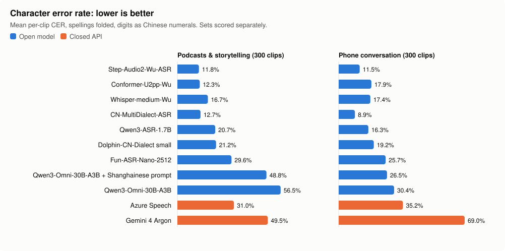

# shanghainese-asr-evals-open-and-closed

Which speech-to-text model is best for Shanghainese (Wu)? We ran open and paid models on the same 600 clips, from two
test sets, and scored them by character error rate.

**Built on the work of others:**

- **[WenetSpeech-Wu](https://arxiv.org/abs/2601.11027)** (ASLP@NPU) made four of the models tested here and
  WenetSpeech-Wu-Bench, one of our two test sets.
- **[Our Cantonese evals](https://github.com/jdhe1120/cantonese-asr-evals-open-and-closed)** are the same harness and
  method, for Cantonese.

[Other credits](#acknowledgements) are at the bottom.

## Best model by task

- **Best overall: [Step-Audio2-Wu-ASR](https://huggingface.co/ASLP-lab/WenetSpeech-Wu-Speech-Understanding)**, from
  WenetSpeech-Wu. It is at or near the top on both test sets and writes closest to the teaching spelling (best strict
  score on both). It has 8.3B parameters, so it needs a rented GPU.
- **Best on a laptop: [CN-MultiDialect-ASR](https://huggingface.co/ASLP-lab/CN-MultiDialect-ASR)**, best on phone
  conversation and within a point of the lead on podcasts. It hears well but writes the phone corpus's own spellings
  (吾, 伐 for 勿), so it falls behind in strict.
- **Best paid API:** Azure Speech (`wuu-CN`), the only one found with a Wu setting, well behind every Wu-trained open
  model.
- **Bigger isn't better: Qwen3-Omni-30B-A3B**, the 30B model Qwen3-ASR was trained from, trails its 1.7B offspring on
  every set: 26-30% on phone conversation against 16%, and on podcasts it cuts sentences short, invents text and once
  repeats a phrase until it runs out of tokens (49-57%). Naming Shanghainese in the prompt helps by a few points.
- **General models given a transcription prompt (Gemini 4 Argon)** write fluent Shanghainese that often isn't what was
  said. At 50-69%, and about 50% even on clean read speech, it isn't usable for Wu.

<!-- results:begin -->
| Test set | Best | Within a point |
|---|---|---|
| Podcasts & storytelling | **Step-Audio2-Wu-ASR** 11.8% ‡ | Conformer-U2pp-Wu 12.3% ‡, CN-MultiDialect-ASR 12.7% ‡ |
| Phone conversation | **CN-MultiDialect-ASR** 8.9% ‡ | – |

## Overall



| Model | Built on | Type | Podcasts & storytelling (300) | Phone conversation (300) |
|---|---|---|---|---|
| Step-Audio2-Wu-ASR | Step-Audio-2-mini, tuned on WenetSpeech-Wu | open | 11.8% ‡ | 11.5% |
| Conformer-U2pp-Wu | Conformer, trained only on WenetSpeech-Wu | open | 12.3% ‡ | 17.9% |
| Whisper-medium-Wu | Whisper-medium, tuned on WenetSpeech-Wu | open | 16.7% ‡ | 17.4% |
| CN-MultiDialect-ASR | Qwen3-ASR-1.7B, tuned on dialect data | open | 12.7% ‡ | 8.9% ‡ |
| Qwen3-ASR-1.7B | Qwen3-ASR-1.7B, stock | open | 20.7% | 16.3% |
| Dolphin-CN-Dialect small | Dolphin (DataoceanAI) | open | 21.2% | 19.2% |
| Fun-ASR-Nano-2512 | Fun-ASR (Tongyi) | open | 29.6% | 25.7% |
| Qwen3-Omni-30B-A3B + Shanghainese prompt | Qwen3-Omni-30B-A3B, stock | open | 48.8% | 26.5% |
| Qwen3-Omni-30B-A3B | Qwen3-Omni-30B-A3B, stock | open | 56.5% | 30.4% |
| Azure Speech | Microsoft, model not named | closed | 31.0% | 35.2% |
| Gemini 4 Argon | Google general model, prompted | closed | 49.5% | 69.0% |

Mean per-clip character error rate, spellings folded, digits → 中文. Open models first, then closed APIs, better models first within each; models on the same base model sit together. ‡ familiar data: the set closely resembles that model's training data, so its score is probably better than on new audio (see below). Every view, every Podcasts & storytelling transcript, and the notes behind each ‡ are in [`results/`](results/summary.md) (run `20261106T075553Z`).
<!-- results:end -->

**How to read this**

- A gap of a point or two is noise.
- **Built on** says what each model started from and what Wu data it was trained on. CN-MultiDialect-ASR is
  Qwen3-ASR-1.7B fine-tuned for dialects, so the row below it shows what that fine-tuning adds. Three models share the
  WenetSpeech-Wu training corpus, from the lab that built the Podcasts & storytelling test set.
- **The two test sets are scored separately and never averaged.** Podcasts and storytelling is clean, mostly
  monologue speech; phone conversation is two people talking over a phone line. A model can be good at one and not the
  other, so compare models within a column.
- **Spellings folded** counts the same word written with different characters as a match (我/吾, 勿/弗, 末/么),
  because Wu has no single standard spelling. The pairs are ones the author judged reasonable after listening to the phone
  conversation clips, each with its reason, in [`rules/wu_folds.toml`](rules/wu_folds.toml); it's a judgement call, not
  a standard. Podcasts and
  storytelling uses the same list; spelling variants found only there count as errors. A different word, or a Mandarin word written for a Wu one (这 for 搿,
  的 for 个), stays an error. Pairs don't chain: 末=么 and 么=嘛 don't make 末=嘛.
- **Strict** asks more: the model has to write one teaching spelling, the one Qian Nairong's dictionary
  《上海话大词典》 uses (勿 for veq, 伐 only for the question particle, 个, 我, 人 ...). Each reference is rewritten
  into it at scoring time ([`rules/wu_canonical.toml`](rules/wu_canonical.toml)). Strict numbers are in
  [`results/summary.md`](results/summary.md).
- **‡ familiar data.** The test set closely resembles that model's training data, so its score is probably better
  than it would be on new audio. Either the model's makers also built the test set, likely from the same kinds of
  sources as their training data (the four ASLP@NPU models on Podcasts & storytelling get 10-19% of clips exactly right,
  every other model 3% or less), or the model learned the references' own spelling and punctuation (CN-MultiDialect-ASR
  on phone conversation: 15% word for word, punctuation included, against 0-2%; it still doesn't copy the references'
  known typos, so it likely isn't recalling these clips). On our own recordings, which no model can have trained on, the same
  four models are still the top four. The evidence is in [`results/summary.md`](results/summary.md#familiar-data).
- **Gemini 4 Argon** is prompted the same way as in our Cantonese evals, with the language swapped.
- Phone conversation is scores only: its licence doesn't allow republishing the text. Every other transcript is in
  [`results/per_clip.csv`](results/per_clip.csv).

More detail is in [`docs/details.md`](docs/details.md).

## Run it

You need Python 3.12, [uv](https://docs.astral.sh/uv/) and `ffmpeg`.

```
uv sync
uv run python -m shaeval ui                          # browse the results and diffs; needs no audio
uv run python scripts/fetch_models.py                # the three models that don't download themselves
uv run python -m shaeval check                       # verify the clips and scoring
uv run python -m shaeval run --no-ui --models all    # transcribe and score (free models only)
```

Transcribing needs the clips (below). Paid models have to be named (`--models azure-wuu`) and need keys:
`cp .env.example .env`, then fill in what you run.

| Model | Needs |
|---|---|
| `azure-wuu` | `AZURE_SPEECH_ENDPOINT`, `AZURE_SPEECH_KEY` |
| `gemini-argon` | `GEMINI_API` |
| `step-audio2-wu` | a [Modal](https://modal.com) account: 8.3B parameters, run on a rented GPU (below) |
| `qwen3-omni`, `qwen3-omni-wu` | Modal too: 30B parameters, an 80 GB GPU (below) |

Step-Audio2-Wu-ASR is too big for a laptop, so it runs on a rented A100 on Modal. Nothing stays deployed: each run
starts the GPU, transcribes every uncached clip in one batch, and shuts down. 300 clips took about 5 minutes and cost
under $0.20 (October 2026 pricing), well inside Modal's monthly free credit.

```
uv run modal setup                                           # once: log in to Modal
uv run modal run modal_apps/step_audio2_wu.py::download      # once: weights into a Modal volume (CPU only, ~17 GB)
uv run python -m shaeval run --no-ui --models step-audio2-wu
```

Qwen3-Omni works the same way: `modal_apps/qwen3_omni.py::download` once (~70 GB), then `--models qwen3-omni
qwen3-omni-wu` (one row per prompt: Qwen's Chinese transcription prompt, and one naming Shanghainese).

## Test data

| Test set | Source | Clips | License | What it tests |
|---|---|---|---|---|
| Podcasts & storytelling | [WenetSpeech-Wu-Bench](https://huggingface.co/datasets/ASLP-lab/WenetSpeech-Wu-Bench) ASR test set (ASLP@NPU) | 300 of 4,851 | Apache-2.0 | Podcasts, broadcast and Shanghainese storytelling; some Suzhounese and Mandarin mixed in |
| Phone conversation | [MagicData Shanghai Dialect Conversational Speech Corpus](https://magichub.com/datasets/shanghai-dialect-conversational-speech-corpus/) (sample) | 300 of 4,546 | All rights reserved | Two Shanghai speakers aged 47-69 on the phone |

Neither set is safe from training data: WenetSpeech-Wu-Bench is its makers' own held-out test set, and the WenetSpeech-Wu
authors had the MagicData sample (27 of its clips are voice prompts in their benchmark). A third set no model could have
trained on, the author reading sentences from the
[Shanghai Spoken Corpus](https://sites.ualberta.ca/~johnnewm/SC/Shanghai/About.html) aloud, is in progress: 50 clips so
far, [on Hugging Face](https://huggingface.co/datasets/jdhe1120/shanghainese-ssc-read-speech) for evaluation only (gated: request access; no training, voice cloning or redistribution).

### Getting the clips

```
uv run python scripts/prepare_wubench.py             # Podcasts & storytelling (downloads 1 GB)
uv run python scripts/prepare_magicdata.py           # Phone conversation, after downloading the corpus (below)
uv run python scripts/fetch_ssc.py                   # One reader, after your access request is accepted (hf auth login)
```

Clips are 1.5-20 s with at least 4 characters, sampled with a fixed seed, so the same command gives the same clips.
For phone conversation, download the corpus from MagicHub into `Shanghai_Dialect_Conversational_Speech_Corpus/` first;
the script keeps one speaker's clean speech (no overlap, no unintelligible parts).

How each set was sampled, and what to watch for in it, is in [`docs/details.md`](docs/details.md#test-data).

## License

The code is MIT (`LICENSE`). The Podcasts & storytelling references and transcripts in `results/` come from
WenetSpeech-Wu-Bench and stay under its Apache-2.0 license; the One reader references are sentences from the Shanghai
Spoken Corpus. No MagicData text or audio is in this repo.

## Acknowledgements

- **Models.** Whisper-medium-Wu, Conformer-U2pp-Wu and Step-Audio2-Wu-ASR are from
  [WenetSpeech-Wu](https://huggingface.co/ASLP-lab/WenetSpeech-Wu-Speech-Understanding) (ASLP@NPU, Apache-2.0), and
  [CN-MultiDialect-ASR](https://huggingface.co/ASLP-lab/CN-MultiDialect-ASR) is from the same lab. Qwen3-ASR (Alibaba Qwen), Fun-ASR-Nano
  (Tongyi FunAudioLLM) and Dolphin-CN-Dialect (DataoceanAI) are open models; Azure Speech and Gemini are paid APIs.
- **Data.** WenetSpeech-Wu-Bench by ASLP@NPU; the Shanghai Dialect Conversational Speech Corpus by Magic Data Technology.
- **Spelling.** The teaching convention follows Qian Nairong's 《上海话大词典》.

